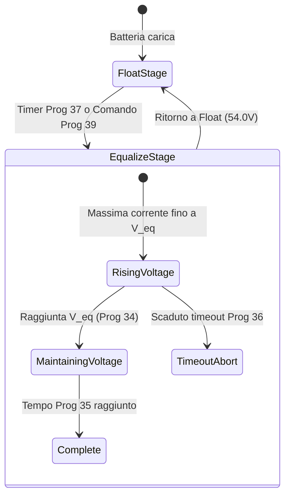

# Manuale Utente Inverter / Caricabatterie PIP-MS 1KVA-5KVA (PF1)

> **Modelli supportati:** PIP-MS 1KVA 12V/24V/48V, 2KVA 24V/48V, 3KVA 24V/48V, 4KVA 48V, 5KVA 48V (PF 1.0) con regolatore di carica solare MPPT integrato.  
> **Versione manuale:** 1.0 (2019-01-09)  
> **Documento convertito:** Estratto e strutturato a partire dal file originale `PIP-MS_1-5KVA_manual-20190109.pdf`.

---

## Indice dei Contenuti
1. [Scopo e Istruzioni di Sicurezza](#1-scopo-e-istruzioni-di-sicurezza)
2. [Introduzione e Panoramica Prodotto](#2-introduzione-e-panoramica-prodotto)
3. [Installazione e Cablaggio](#3-installazione-e-cablaggio)
   - [Montaggio dell'unità](#montaggio-dellunità)
   - [Collegamento Batteria](#collegamento-batteria)
   - [Collegamento AC Input / Output](#collegamento-ac-input--output)
   - [Collegamento Moduli Fotovoltaici (PV)](#collegamento-moduli-fotovoltaici-pv)
   - [Porte di Comunicazione e Contatto Pulito (Dry Contact)](#porte-di-comunicazione-e-contatto-pulito-dry-contact)
4. [Funzionamento e Display LCD](#4-funzionamento-e-display-lcd)
   - [Pannello Operativo, LED e Tasti](#pannello-operativo-led-e-tasti)
   - [Icone e Indicatori del Display LCD](#icone-e-indicatori-del-display-lcd)
   - [Schermate Informative del Display](#schermate-informative-del-display)
5. [Programmi di Configurazione LCD (Programmi 00 - 39)](#5-programmi-di-configurazione-lcd-programmi-00---39)
6. [Modalità Operative](#6-modalità-operative)
7. [Codici di Errore (Fault Reference Code)](#7-codici-di-errore-fault-reference-code)
8. [Indicatori di Avviso (Warning Indicators)](#8-indicatori-di-avviso-warning-indicators)
9. [Funzione di Equalizzazione Batteria](#9-funzione-di-equalizzazione-batteria)
10. [Specifiche Tecniche](#10-specifiche-tecniche)
    - [Specifiche Line Mode (Modalità Rete)](#specifiche-line-mode-modalità-rete)
    - [Specifiche Inverter Mode (Modalità Batteria)](#specifiche-inverter-mode-modalità-batteria)
    - [Specifiche Caricabatterie da Rete (Utility Charging)](#specifiche-caricabatterie-da-rete-utility-charging)
    - [Specifiche Caricabatterie Solare MPPT](#specifiche-caricabatterie-solare-mppt)
11. [Guida alla Risoluzione dei Problemi (Troubleshooting)](#11-guida-alla-risoluzione-dei-problemi-troubleshooting)

---

## 1. Scopo e Istruzioni di Sicurezza

### Scopo
Questo manuale descrive l'assemblaggio, l'installazione, il funzionamento e la risoluzione dei problemi per gli inverter ad onda sinusoidale pura serie PIP-MS 1KVA - 5KVA con fattore di potenza unitario (PF=1.0) e regolatore solare MPPT.

### Istruzioni di Sicurezza
- **Attenzione:** Prima dell'uso, leggere tutte le istruzioni e le avvertenze sull'unità, sulle batterie e nelle sezioni pertinenti di questo manuale.
- **Tipo di batterie:** Per ridurre il rischio di infortuni, caricare solo batterie ricaricabili al piombo deep-cycle (AGM, Gel o ad acido libero Flooded) o pacchi compatibili configurati secondo le specifiche del costruttore.
- **Non disassemblare:** L'unità non contiene parti riparabili dall'utente finale. Portarla presso centri di assistenza qualificati.
- **Scollegamento:** Per ridurre il rischio di shock elettrico, disconnettere tutti i cablaggi (AC, DC batteria e fotovoltaico) prima di qualsiasi operazione di pulizia o manutenzione.
- **Messa a terra:** Questa unità deve essere collegata a un sistema di messa a terra permanente e conforme alle normative vigenti.
- **Fusibili e protezione DC:** È richiesto installare un dispositivo di protezione da sovracorrente DC (fusibile o sezionatore magnetotermico) tra batteria e inverter.

---

## 2. Introduzione e Panoramica Prodotto

L'inverter/caricabatterie combina tre funzioni fondamentali in un unico dispositivo compatto:
1. Inverter DC/AC ad onda sinusoidale pura (Power Factor = 1.0).
2. Caricabatterie solare ad inseguimento di massima potenza (MPPT).
3. Caricabatterie da rete AC / generatore con correzione del fattore di potenza.

### Caratteristiche Principali
- Onda sinusoidale pura in uscita (Pure Sine Wave).
- Regolatore di carica solare MPPT integrato ad alta efficienza.
- Range di tensione di ingresso AC configurabile da LCD (modalità Appliances per elettrodomestici 90-280 Vac o UPS per PC/elettronica sensibile 170-280 Vac).
- Corrente di carica batteria configurabile da LCD in base alla capacità del banco batterie.
- Priorità configurabile tra caricatore AC e Solare.
- Compatibile sia con tensione di rete (Utility) che con gruppo elettrogeno (Generator).
- Riavvio automatico al ripristino dell'alimentazione di rete AC.
- Protezioni integrate contro sovraccarico, sovratemperatura e cortocircuito.
- Sistema intelligente di ricarica batteria a più stadi per ottimizzare le prestazioni e la durata della batteria (inclusa funzione di equalizzazione).
- Funzione di avviamento a freddo (Cold Start).

### Panoramica Interfacce e Connessioni (Modelli 1K-5K)
1. Display LCD
2. Indicatore di stato (LED Verde)
3. Indicatore di ricarica (LED Verde)
4. Indicatore di errore/guasto (LED Rosso)
5. Tasti funzione: `ESC`, `UP`, `DOWN`, `ENTER`
6. Interruttore generale di alimentazione (Power on/off switch)
7. Morsetti AC input (L, N, GND)
8. Morsetti AC output (L, N, GND)
9. Morsetti di ingresso fotovoltaico PV (+, -)
10. Morsetti batteria (+, -)
11. Interruttore termico di ingresso AC (Circuit Breaker)
12. Porta di comunicazione seriale (RS-232 / USB dove equipaggiato)
13. Porta contatto pulito (Dry Contact: NC, C, NO)

---

## 3. Installazione e Cablaggio

### Montaggio dell'unità
- Installare verticalmente su una superficie piana e incombustibile (es. calcestruzzo o metallo).
- Lasciare almeno 20 cm di spazio sui lati e 50 cm sopra/sotto per consentire una corretta ventilazione e il flusso d'aria delle ventole.
- Temperatura operativa ottimale: 0°C ~ 55°C.

### Collegamento Batteria
Per la massima efficienza e sicurezza, utilizzare cavi di sezione adeguata e capicorda ad anello (ring terminal) con vite serrata a **2 ~ 3 Nm**.

| Modello Inverter | Tensione Nominale | Corrente Tipica Max | Capacità Minima Batteria | Sezione Cavo Singolo / Doppio | Diametro Anello (D) | Lunghezza Anello (L) | Coppia di Serraggio |
| :--- | :--- | :--- | :--- | :--- | :--- | :--- | :--- |
| **1KVA / 2KVA** | 12V / 24V | 109A | 100 Ah | 1x 4AWG (22 mm²) / 2x 8AWG (16 mm²) | 6.4 mm | 29.2 mm / 23.8 mm | 2 ~ 3 Nm |
| **3KVA** | 24V / 48V | 164A | 100 Ah / 200 Ah | 1x 2AWG (38 mm²) / 2x 6AWG (28 mm²) | 6.4 mm | 33.2 mm / 29.2 mm | 2 ~ 3 Nm |
| **4KVA** | 48V | 110A | 200 Ah | 1x 4AWG (22 mm²) / 2x 8AWG (16 mm²) | 6.4 mm | 39.2 mm / 33.2 mm | 2 ~ 3 Nm |
| **5KVA** | 48V | 137A | 200 Ah | 1x 2AWG (38 mm²) / 2x 6AWG (28 mm²) | 6.4 mm | 39.2 mm / 33.2 mm | 2 ~ 3 Nm |

> [!CAUTION]
> - Installare sempre un fusibile o un sezionatore magnetotermico DC idoneo vicino alla batteria.
> - Rispettare rigorosamente la polarità (+ con + e - con -). Un'inversione di polarità brucia i fusibili interni e danneggia l'inverter.

### Collegamento AC Input / Output
Prima di effettuare il collegamento, accertarsi di inserire un interruttore di protezione magnetotermico AC dedicato sulla linea di alimentazione:
- 1KVA: 10A
- 2KVA: 20A
- 3KVA: 32A
- 4KVA: 40A
- 5KVA: 50A

| Modello | Sezione Cavi AC Consigliata | Coppia di Serraggio |
| :--- | :--- | :--- |
| **1KVA** | 16 AWG (1.5 mm²) | 0.5 ~ 0.6 Nm |
| **2KVA** | 14 AWG (2.5 mm²) | 0.8 ~ 1.0 Nm |
| **3KVA** | 12 AWG (4.0 mm²) | 1.2 ~ 1.6 Nm |
| **4KVA** | 10 AWG (6.0 mm²) | 1.4 ~ 1.6 Nm |
| **5KVA** | 8 AWG (10.0 mm²) | 1.4 ~ 1.6 Nm |

### Collegamento Moduli Fotovoltaici (PV)
- Installare un sezionatore magnetotermico DC tra stringa fotovoltaica e inverter.
- Verificare che la tensione a vuoto (Voc) dei moduli **non superi mai la tensione massima Voc ammessa** dall'inverter in alcuna condizione di temperatura minima.
- Verificare che la tensione Voc sia superiore alla tensione minima di batteria.

| Parametro PV | 1KVA 12V | 1KVA 24V / 2KVA 24V / 3KVA 24V | 1KVA 48V / 3KVA 48V | 2KVA 24V Plus / 3KVA 24V Plus | 2KVA 48V Plus / 3KVA 48V Plus / **4KVA / 5KVA** |
| :--- | :--- | :--- | :--- | :--- | :--- |
| **Max. PV Array Open Circuit Voltage (Voc)** | 102 Vdc | 75 Vdc | 102 Vdc | 145 Vdc | **145 Vdc** |
| **Range Tensione MPPT** | 15 ~ 80 Vdc | 30 ~ 66 Vdc | 60 ~ 88 Vdc | 30 ~ 115 Vdc | **60 ~ 115 Vdc** |
| **Tensione Minima Batteria per Carica PV** | 8.5 Vdc | 17 Vdc | 34 Vdc | 17 Vdc | **34 Vdc** |

### Porte di Comunicazione e Contatto Pulito (Dry Contact)
Sul fondo dell'inverter è presente una porta seriale DB9/RJ45 per collegamento PC/Raspberry (protocollo PI30) e un connettore a 3 poli per contatto pulito a relè (3A / 250VAC):
- **NC**: Normalmente Chiuso
- **C**: Comune
- **NO**: Normalmente Aperto

#### Tabella logica del Contatto Pulito (Programma 38 = Disable, predefinito)
| Stato Unità | Condizione | Contatto NC & C | Contatto NO & C |
| :--- | :--- | :--- | :--- |
| **Power Off** | Unità spenta, nessuna uscita | Chiuso | Aperto |
| **Power On** (Linea) | Uscita alimentata da rete elettrica | Chiuso | Aperto |
| **Power On** (Batteria/Solare) | Programma 01 impostato su Utility: Batteria < Tensione allarme Low DC | Aperto | Chiuso |
| **Power On** (Batteria/Solare) | Programma 01 su Utility: Batteria > Tensione Prog. 13 o carica in float | Chiuso | Aperto |
| **Power On** (Batteria/Solare) | Programma 01 su SBU o Solar first: Batteria < Tensione Prog. 12 | Aperto | Chiuso |
| **Power On** (Batteria/Solare) | Programma 01 su SBU o Solar first: Batteria > Tensione Prog. 13 o carica in float | Chiuso | Aperto |

*Nota:* Quando il Programma 38 è impostato su `Enable`, il contatto pulito serve a comandare la Grounding Box per connettere neutro e terra quando l'inverter lavora in isola (Battery mode).

---

## 4. Funzionamento e Display LCD

### Pannello Operativo, LED e Tasti
Tre indicatori LED indicano lo stato:
- **Status (Verde):** Fisso = Uscita alimentata da rete elettrica; Lampeggiante = Uscita alimentata da batteria o fotovoltaico.
- **Charging (Verde):** Fisso = Batteria completamente carica; Lampeggiante = Batteria in fase di carica.
- **Fault (Rosso):** Fisso = Errore bloccante (Fault mode); Lampeggiante = Allarme non bloccante (Warning condition).

Quattro tasti funzione:
- **`ESC`**: Esce dalla modalità impostazioni o torna al livello precedente.
- **`UP`**: Scorre all'opzione precedente o alla schermata display precedente.
- **`DOWN`**: Scorre all'opzione successiva o alla schermata display successiva.
- **`ENTER`**: Conferma l'opzione o entra in modalità impostazioni (tenere premuto 3 secondi).

### Icone e Indicatori del Display LCD
- **Input Source Information:** Icona rete AC (`AC`), icona solare (`PV`), display per Tensione, Frequenza, Tensione PV, Tensione batteria, Corrente di carica.
- **Configuration & Fault Information:** `SETTING` (impostazioni attive), numero programma (`00`-`39`), codice numerico di Warning (lampeggiante con icona triangolo d'allarme) o Fault (fisso con codice a due cifre).
- **Output Information:** `LOAD` (presenza carico), percentuali di carico (barre 0-24%, 25-49%, 50-74%, 75-100%), icona sovraccarico, tensione e frequenza di uscita.
- **Battery Information:** Icona batteria con 4 segmenti di tensione e percentuale di carica:
  - Batteria < 20%: lampeggia il livello più basso.
  - 20% ~ 49%: livello 1 fisso, livello 2 lampeggiante.
  - 50% ~ 74%: livelli 1-2 fissi, livello 3 lampeggiante.
  - 75% ~ 100%: livelli 1-3 fissi, livello 4 lampeggiante.
  - Carica completata: tutti e 4 i livelli fissi.
- **Operating Mode Information:**
  - `BYPASS`: carico alimentato direttamente da sorgente di ingresso (rete/generatore).
  - Circuito inverter attivo: indicatore conversione DC/AC.

---

## 5. Programmi di Configurazione LCD (Programmi 00 - 39)

Tenere premuto `ENTER` per 3 secondi per accedere alla programmazione.

| Prog | Descrizione | Opzioni Disponibili | Default | Note e Corrispondenza Protocollo PI30 |
| :---: | :--- | :--- | :---: | :--- |
| **00** | Uscita menu | `ESC` | - | Esce dalla modalità di programmazione |
| **01** | **Priorità sorgente uscita (Output source priority)** | `SOL` (Solar first) `UTI` (Utility first) `SBU` (SBU priority: Solar-Battery-Utility) | **`UTI`** | Comando PI30: `POP00` (Utility), `POP01` (Solar), `POP02` (SBU). SBU privilegia il consumo solare e batteria fino alla soglia del prog. 12 |
| **02** | **Corrente massima di carica totale** (Rete + Solare) | **1K 24V / 1K-3K 48V:** 10A, 20A, 30A, 40A **2K-3K 24V:** 20A, 30A, 40A, 50A, 60A **4K-5K 48V:** da 10A a 140A (step 10A) | **`60A`** (4K/5K) `20A` (1K) `30A` (2-3K) | Comando PI30: `MCHGC0xx`. Configura la corrente combinata massima erogata verso la batteria |
| **03** | **Range tensione AC di ingresso** | `APL` (Appliances: 90 ~ 280 Vac) `UPS` (UPS: 170 ~ 280 Vac) | **`APL`** | Impostare `UPS` se alimentato da rete stabile con PC; `APL` se alimentato da generatore o linea fluttuante |
| **04** | Modalità risparmio energetico | `SdS` (Disable) `SEN` (Enable) | **`SdS`** | Se abilitato, l'inverter spegne l'uscita se il carico è nullo o inferiore a ~50W |
| **05** | **Tipo di batteria** | `AGM` (Batteria ermetica AGM) `FLD` (Batteria ad acido libero Flooded) `USE` (User-Defined: definita dall'utente) | **`AGM`** | Se si seleziona `USE`, i programmi 26 (Bulk), 27 (Float) e 29 (Cut-off) diventano personalizzabili |
| **06** | Riavvio automatico in sovraccarico | `LFD` (Disable) `LFE` (Enable) | **`LFD`** | Se abilitato, l'unità tenta il riavvio automatico dopo un sovraccarico |
| **07** | Riavvio automatico in sovratemperatura | `tFD` (Disable) `tFE` (Enable) | **`tFD`** | Se abilitato, riavvia l'inverter una volta scesa la temperatura |
| **09** | Frequenza nominale di uscita | `50` (50 Hz) `60` (60 Hz) | **`50`** | Frequenza erogata in modalità batteria |
| **11** | **Massima corrente di carica da rete (Utility)** | **4K/5K 48V:** 2A, 10A, 20A, 30A, 40A, 50A, 60A | **`30A`** (4K/5K) | Comando PI30: `MUCHGC0xx`. Determina la corrente prelevata dal caricatore AC di bordo |
| **12** | **Tensione di ritorno a rete (Back to Utility)** | **Per modelli 48V:** Da 44.0V a 51.0V (step 1V) (Per 24V: 22.0V ~ 25.5V) | **`46.0V`** (48V) `23.0V` (24V) | Comando PI30: `PBCVxx.x`. In modalità SBU o Solar first, se la batteria scende a questa soglia l'inverter commuta su rete |
| **13** | **Tensione di ritorno a batteria (Back to Battery)** | **Per modelli 48V:** `FUL` (batteria carica) o da 48.0V a 58.0V (step 1V) (Per 24V: 24.0V ~ 29.0V) | **`54.0V`** (48V) `27.0V` (24V) | Comando PI30: `PBDVxx.x`. In modalità SBU o Solar first, al raggiungimento di questa tensione l'inverter ricommuta a batteria |
| **16** | **Priorità caricabatterie (Charger source priority)** | `CSO` (Solar first: carica solare prioritaria, rete subentra solo se FV assente) `CUT` (Utility first: carica da rete prioritaria) `SNU` (Solar and Utility: carica combinata simultanea) `OSO` (Only Solar: carica esclusivamente dal sole) | **`SNU`** (4K/5K) `CSO` (1-3K) | Comando PI30: `PCP00` (UTI), `PCP01` (SOL), `PCP02` (SNU), `PCP03` (OSO). Determina quali sorgenti caricano la batteria |
| **18** | Controllo allarme sonoro (Buzzer) | `bON` (Abilitato) `bOF` (Disabilitato / Silenzioso) | **`bON`** | Disabilita i bip continui di avviso |
| **19** | Ritorno automatico alla schermata display default | `ESP` (Torna alla prima schermata dopo 1 minuto) `FEP` (Resta sull'ultima schermata selezionata) | **`ESP`** | Controllo del comportamento display |
| **20** | Retroilluminazione display | `LON` (Sempre accesa) `LOF` (Si spegne dopo 1 minuto di inattività) | **`LON`** | Risparmio display |
| **22** | Suono alla perdita della sorgente primaria | `AON` (Suona quando la rete si interrompe) `AOF` (Nessun allarme) | **`AON`** | Utile per essere avvisati di un blackout |
| **23** | Bypass da sovraccarico | `byD` (Disabilitato) `byE` (Abilitato: commuta su rete in sovraccarico) | **`byD`** | Se abilitato in battery mode, in caso di sovraccarico commuta su rete senza andare in blocco |
| **25** | Registrazione codice di errore | `FEN` (Abilitato) `FDS` (Disabilitato) | **`FEN`** | Registra lo storico guasti |
| **26** | **Tensione di carica Bulk (C.V. voltage)** | **48V:** 48.0V ~ 58.4V (o fino a 64.0V nei modelli a 64V). Step 0.1V | **`56.4V`** (48V) `28.2V` (24V) | Comando PI30: `PCVVxx.x`. Tensione della fase ad assorbimento costante (Bulk/Absorption) |
| **27** | **Tensione di carica di mantenimento (Float)** | **48V:** 48.0V ~ 58.4V (o fino a 64.0V). Step 0.1V | **`54.0V`** (48V) `27.0V` (24V) | Comando PI30: `PBFTxx.x`. Tensione mantenuta a carica ultimata |
| **29** | **Tensione di cut-off DC bassa (Low DC cut-off)** | **48V:** 40.0V ~ 48.0V. Step 0.1V | **`42.0V`** (48V) `21.0V` (24V) | Comando PI30: `PSDVxx.x`. Tensione sotto la quale l'inverter stacca l'uscita per salvaguardare le batterie |
| **31** | Bilanciamento potenza solare (Solar Power Balance) | `SbE` (Enable: Potenza FV = Carica batteria + Carico erogato) `SbD` (Disable: Potenza FV = Carica batteria max) | **`SbE`** | Consente al regolatore MPPT di alimentare direttamente anche i carichi AC |
| **32** | Tempo massimo di carica (Max charging time) | Da 5 a 900 minuti (solo modelli 1-3K) | `900 min` | - |
| **33** | **Funzione Equalizzazione Batteria** | `EdS` (Disable: disabilitata) `EEN` (Enable: abilitata) | **`EdS`** | Attiva il ciclo periodico di equalizzazione |
| **34** | **Tensione di equalizzazione** | **48V:** 48.0V ~ 58.4V (o fino a 64.0V). Step 0.1V | **`58.4V`** (48V) | Tensione applicata durante la fase di equalizzazione |
| **35** | **Durata equalizzazione (Equalized time)** | Da 5 a 900 minuti (step 5 min) | **`60 min`** | Tempo trascorso alla tensione di equalizzazione |
| **36** | **Timeout di equalizzazione (Equalized timeout)** | Da 5 a 900 minuti (step 5 min) | **`120 min`** | Tempo massimo concesso per raggiungere la tensione di equalizzazione |
| **37** | **Intervallo di equalizzazione** | Da 0 a 90 giorni (step 1 giorno) | **`30 giorni`** | Periodicità con cui si ripete il ciclo automatico |
| **38** | Controllo Grounding Box / Relè Neutro-Terra | `GdS` (Disable: contatto pulito per allarme batteria) `GEN` (Enable: contatto pulito per scatola di terra) | **`GdS`** | Determina la funzione assegnata alla morsettiera dry contact |
| **39** | **Attivazione immediata equalizzazione** | `AEN` (Attiva subito il ciclo di equalizzazione) `ADS` (Disattiva / termina ciclo in corso) | **`ADS`** | Forza l'inizio dell'equalizzazione senza attendere l'intervallo |

---

## 6. Modalità Operative

| Modalità | Descrizione | Display & Flusso di Potenza |
| :--- | :--- | :--- |
| **Standby Mode / Power Saving Mode** | L'inverter non fornisce alimentazione in uscita (carichi spenti), ma i circuiti di ricarica da rete AC o da pannelli FV sono operativi e caricano la batteria. | Nessun simbolo di carico. Simbolo rete e/o pannello fotovoltaico che alimentano la batteria. |
| **Fault Mode** | Si è verificato un errore bloccante interno o sui circuiti esterni. L'uscita è disattivata per sicurezza. La ricarica può rimanere parzialmente attiva se il guasto non riguarda il bus o i caricabatterie. | Icona triangolo di guasto accesa fissa con visualizzazione del codice di errore (Fault Code). |
| **Line Mode (Modalità Rete)** | L'unità eroga energia ai carichi prelevandola dalla rete AC (o generatore). Contemporaneamente carica la batteria con solare e/o rete. | Icona `AC` collegata direttamente al carico (`BYPASS`). Icona fotovoltaico/rete collegata alla batteria. |
| **Battery Mode (Modalità Batteria / Isola)** | L'unità converte la corrente continua delle batterie e l'energia fotovoltaica per fornire alimentazione a 230 Vac pura sinusoidale ai carichi collegati. | Batteria e pannelli PV forniscono energia all'inverter, che alimenta il carico. Rete AC scollegata o assente. |

---

## 7. Codici di Errore (Fault Reference Code)

Quando si verifica un errore critico, l'inverter entra in modalità guasto (Fault Mode), il LED rosso si accende fisso, il buzzer suona con tono continuo e sul display compare il codice numerico a due cifre.

| Codice Fault | Nome Evento nel Manuale | Causa Probabile | Azione Richiesta / Risoluzione |
| :---: | :--- | :--- | :--- |
| **`01`** | **Fan is locked when inverter is off** | Ventola di raffreddamento bloccata o guasta | Controllare che corpi estranei non blocchino le pale della ventola; sostituire la ventola. |
| **`02`** | **Over temperature** | Sovratemperatura interna: convertitore DC/DC > 120°C (1-3K) oppure ponte inverter > 100°C | Verificare che i condotti di aerazione non siano ostruiti e che la temperatura ambiente sia entro i limiti (< 50°C). |
| **`03`** | **Battery voltage is too high** | Tensione del banco batterie superiore alla soglia massima ammessa | Verificare che il numero di batterie e le tensioni bulk/float siano corrette per il banco installato. |
| **`04`** | **Battery voltage is too low** | Tensione batteria scesa sotto la soglia minima critica | Ricaricare il banco batterie; verificare se una o più celle sono danneggiate. |
| **`05`** | **Output short circuited or converter overtemp** | Cortocircuito sulla linea di uscita AC o sovraccarico istantaneo violento | Verificare il cablaggio dei carichi AC a valle, rimuovere carichi anomali in corto. |
| **`06`** | **Output voltage is abnormal (1K-3K) / Output too high (4K-5K)** | Tensione di uscita non corretta o superiore a 260 Vac | Ridurre il carico; se persiste con carico nullo, guasto stadio di uscita (assistenza). |
| **`07`** | **Overload time out** | Sovraccarico continuato oltre il limite ammesso (110% scaduto o 150% immediato) | Ridurre la potenza dei carichi collegati spegnendo apparecchiature energivore. |
| **`08`** | **Bus voltage is too high** | Tensione del bus DC intermedio oltre la soglia massima consentita | Possibile sovratensione fotovoltaica o rimbalzo induttivo carichi. Riavviare l'unità. |
| **`09`** | **Bus soft start failed** | Fallito l'avvio dolce (pre-carica) dei condensatori del bus DC | Guasto hardware circuito soft-start interno (necessario centro assistenza). |
| **`11`** | **Main relay failed** | Relè principale di commutazione linea/inverter guasto o incollato | Controllare i collegamenti di terra e rete. Assistenza se persiste. |
| **`51`** | **Over current or surge** *(solo 4K/5K)* | Sovracorrente istantanea o transitorio violento sui transistor di potenza | Riavviare l'unità. Se l'errore si ripresenta a carico scollegato, componente di potenza in avaria. |
| **`52`** | **Bus voltage is too low** *(solo 4K/5K)* | Tensione del bus DC interno collassata sotto la soglia di funzionamento | Sovraccarico o guasto stadio booster DC/DC. Riavviare l'unità. |
| **`53`** | **Inverter soft start failed** *(solo 4K/5K)* | Avvio dolce dell'inverter fallito | Sovraccarico all'accensione o carichi capacitivi elevati. Scollegare i carichi e riavviare. |
| **`55`** | **Over DC voltage in AC output** *(solo 4K/5K)* | Componente continua presente sulla tensione alternata di uscita (tensione sbilanciata) | Spegnere e riavviare. Se persiste, guasto stadio modulatore inverter. |
| **`56`** | **Battery connection is open** *(solo 4K/5K)* | Batteria scollegata, cavo allentato o fusibile DC bruciato | Verificare i morsetti della batteria, il sezionatore DC e il fusibile di linea. |
| **`57`** | **Current sensor failed** *(solo 4K/5K)* | Sensore di corrente interno guasto o fuori calibrazione | Assistenza tecnica autorizzata. |
| **`58`** | **Output voltage is too low** *(solo 4K/5K)* | Tensione di uscita dell'inverter scesa sotto 190 Vac | Ridurre il carico connesso; verificare stabilità delle batterie. |

> [!NOTE]
> I codici di errore `51`, `52`, `53`, `55`, `56`, `57` e `58` sono specifici dei modelli da **4KVA e 5KVA**.

---

## 8. Indicatori di Avviso (Warning Indicators)

In presenza di una condizione di avviso (non bloccante), l'inverter continua ad erogare alimentazione, il LED rosso lampeggia e l'icona triangolare di warning lampeggia sul display alternandosi con il codice di avviso.

| Codice Warning | Evento di Avviso | Segnale Acustico (Buzzer) | Condizione e Azione |
| :---: | :--- | :--- | :--- |
| **`01`** | **Fan is locked when inverter is on** | 3 bip ogni secondo | Ventola bloccata con inverter operativo. Pulire o sostituire la ventola per evitare spegnimento per surriscaldamento. |
| **`03`** | **Battery is over-charged** | 1 bip al secondo | Batteria sovraccarica (tensione superiore alle soglie limite). Verificare parametri 26 e 27. |
| **`04`** | **Low battery** | 1 bip al secondo | Tensione batteria in esaurimento (sotto soglia di allarme). Prepararsi al distacco o commutare su rete. |
| **`07`** | **Overload** | 1 bip ogni 0.5 secondi | Carico collegato superiore al 100% della potenza nominale. Ridurre i carichi prima dello scatto per timeout. |
| **`10`** | **Output power derating** | 2 bip ogni 3 secondi | Riduzione automatica della potenza erogata per alta temperatura o bassa tensione di ingresso. |
| **`12`** | **Solar charger stops due to low battery** | Nessun bip | Il regolatore solare ha interrotto la carica a causa di tensione batteria anomala/troppo bassa. |
| **`13`** | **Solar charger stops due to high PV voltage** | Nessun bip | Tensione dei pannelli FV troppo elevata (> 145 Vdc). Ridurre il numero di moduli in serie. |
| **`14`** | **Solar charger stops due to overload** | Nessun bip | Sovraccarico o sovratemperatura sul circuito del caricatore MPPT. |
| **`15`** | **Battery equalization** | Nessun bip | Ciclo di equalizzazione batteria attualmente attivo. |

---

## 9. Funzione di Equalizzazione Batteria

La funzione di equalizzazione è incorporata nel regolatore di carica per annullare gli effetti chimici negativi delle batterie al piombo, in particolare la **stratificazione acida** (differenza di densità tra fondo ed elettrodi superiori) e la **solfatazione** dei piastroni di piombo.

### Fasi del Processo di Equalizzazione
1. **Innesco:** Quando l'intervallo impostato nel Programma 37 viene raggiunto (o manualmente via Programma 39), e la batteria è in floating, l'inverter avvia la fase di Equalize.
2. **Salita a tensione costante:** Il caricatore eroga la massima corrente disponibile fino a portare la tensione al valore configurato nel Programma 34 (es. 58.4V per 48V).
3. **Fase di mantenimento ad alto voltaggio:** Raggiunta la tensione di equalizzazione, essa viene mantenuta per il tempo programmato nel Programma 35 (`Equalized Time`, default 60 min).
4. **Logica di estensione e Timeout:** Se entro il tempo stabilito la batteria non raggiunge la tensione target, il regolatore prolunga il tentativo fino allo scadere dell'`Equalized Timeout` (Programma 36, default 120 min). Se la tensione non viene ancora raggiunta, il ciclo viene interrotto e si torna in modalità Float per proteggere le celle.

---

## 10. Specifiche Tecniche

### Specifiche Line Mode (Modalità Rete)

| Parametro | Modelli 1K-3K | Modelli 4K / 5K |
| :--- | :--- | :--- |
| **Forma d'onda di ingresso** | Sinusoidale (rete o generatore) | Sinusoidale (rete o generatore) |
| **Tensione nominale di ingresso** | 230 Vac | 230 Vac |
| **Tensione minima accettata (Low Loss)** | 170 Vac ± 7V (UPS) / 90 Vac ± 7V (Appliances) | 170 Vac ± 7V (UPS) / 90 Vac ± 7V (Appliances) |
| **Tensione massima accettata (High Loss)** | 280 Vac ± 7V | 280 Vac ± 7V |
| **Frequenza nominale** | 50 Hz / 60 Hz (autoriconoscimento) | 50 Hz / 60 Hz (autoriconoscimento) |
| **Rendimento (Line Mode)** | > 95% (carico resistivo, batteria carica) | > 95% (carico resistivo, batteria carica) |
| **Tempo di trasferimento** | 10 ms tipico (UPS), 20 ms tipico (Appliances) | 10 ms tipico (UPS), 20 ms tipico (Appliances) |

### Specifiche Inverter Mode (Modalità Batteria)

| Parametro | 1KVA 24V / 48V | 2KVA 24V / 48V | 3KVA 24V / 48V | 4KVA 48V | **5KVA 48V** |
| :--- | :--- | :--- | :--- | :--- | :--- |
| **Potenza Nominale** | 1000VA / 1000W | 2000VA / 2000W | 3000VA / 3000W | 4000VA / 4000W | **5000VA / 5000W** |
| **Fattore di Potenza (PF)** | 1.0 | 1.0 | 1.0 | 1.0 | **1.0** |
| **Forma d'onda di uscita** | Onda sinusoidale pura | Onda sinusoidale pura | Onda sinusoidale pura | Onda sinusoidale pura | **Onda sinusoidale pura** |
| **Tensione di uscita regolata** | 230 Vac ± 5% | 230 Vac ± 5% | 230 Vac ± 5% | 230 Vac ± 5% | **230 Vac ± 5%** |
| **Frequenza di uscita** | 50 Hz o 60 Hz | 50 Hz o 60 Hz | 50 Hz o 60 Hz | 50 Hz o 60 Hz | **50 Hz o 60 Hz** |
| **Efficienza di picco** | 90% ~ 93% | 90% ~ 93% | 90% ~ 93% | 93% | **93%** |
| **Potenza di spunto (Surge)** | 2x potenza nominale per 5 secondi | 2x nominale per 5s | 2x nominale per 5s | 2x nominale per 5s | **10.000 VA per 5s** |
| **Tensione Nominale DC** | 24V / 48V | 24V / 48V | 24V / 48V | 48V | **48V** |
| **Tensione Riavvio a Freddo** | 23.0V / 46.0V | 23.0V / 46.0V | 23.0V / 46.0V | 46.0V | **46.0V** |
| **Consumo a vuoto (No Load)** | < 25W | < 30W | < 35W | < 50W | **< 50W** |

### Specifiche Caricabatterie da Rete (Utility Charging)

| Parametro | Modelli 24V | Modelli 48V (1K-3K) | Modelli 48V (**4K/5K**) |
| :--- | :--- | :--- | :--- |
| **Corrente massima di carica da rete** | 20A / 30A | 15A | **2A, 10A, 20A, 30A, 40A, 50A, 60A** |
| **Algoritmo di ricarica** | 3 stadi (Bulk, Absorption, Float) | 3 stadi | 3 stadi (+ Equalizzazione) |
| **Tensione di carica Bulk (AGM)** | 28.2 Vdc | 56.4 Vdc | **56.4 Vdc** |
| **Tensione di carica Bulk (Flooded)** | 28.4 Vdc | 58.4 Vdc | **58.4 Vdc** |
| **Tensione di Float** | 27.0 Vdc | 54.0 Vdc | **54.0 Vdc** |

### Specifiche Caricabatterie Solare MPPT

| Parametro | 1K-3K 24V | 1K-3K 48V | 2K-3K Plus 24V/48V | **4KVA / 5KVA 48V** |
| :--- | :--- | :--- | :--- | :--- |
| **Potenza Nominale FV (Rated Power)** | 600W (24V) | 900W (48V) | 1500W ~ 3000W | **4000 W / 5000 W** |
| **Massima Tensione a Vuoto Voc (Open Circuit)** | 75 Vdc | 102 Vdc | 145 Vdc | **145 Vdc** |
| **Range di Tensione MPPT** | 30 ~ 66 Vdc | 60 ~ 88 Vdc | 30 ~ 115 V / 60 ~ 115 V | **60 ~ 115 Vdc** |
| **Tensione Minima Batteria per Avvio MPPT** | 17 Vdc | 34 Vdc | 17 Vdc / 34 Vdc | **34 Vdc** |
| **Efficienza Massima MPPT** | 98% | 98% | 98% | **98%** |

---

## 11. Guida alla Risoluzione dei Problemi (Troubleshooting)

| Sintomo Riscontrato | Segnalazione LCD / LED / Buzzer | Causa Probabile | Azione Correttiva Consigliata |
| :--- | :--- | :--- | :--- |
| L'unità si spegne subito durante la sequenza di avvio | Display LCD, LED e buzzer attivi per 3 secondi, poi tutto spento | Tensione batteria troppo bassa (< 1.91 V/cella, es. < 45.8V su 48V) | 1. Ricaricare la batteria da rete esterna o solare. 2. Sostituire le batterie esaurite. |
| Nessuna reazione premendo l'interruttore di accensione | Nessuna indicazione a display, LED spenti | 1. Batteria totalmente scarica (< 1.4 V/cella). 2. Polarità batteria invertita. | 1. Verificare serraggio cavi e polarità. 2. Ricaricare le batterie. 3. Verificare fusibile DC interno/esterno. |
| La rete AC è presente ma l'unità lavora in batteria | Tensione AC visualizzata come 0V su LCD e LED verde lampeggiante | Interruttore termico AC (protector) scattato | Verificare se il magnetotermico AC sull'inverter è scattato; verificare cablaggio AC. |
| La rete AC è presente ma l'inverter non commuta su rete | LED verde lampeggia | 1. Qualità della tensione AC insufficiente (generatore o linea instabile). 2. Priorità impostata su "Solar First". | 1. Cambiare impostazione Prog. 03 da `UPS` ad `Appliances`. 2. Cambiare Prog. 01 in `Utility First`. |
| Relè interno scatta ripetutamente all'accensione | Icone LCD e LED lampeggiano ritmicamente | Batteria non collegata stabilmente o morsetto allentato | Verificare che i capicorda della batteria siano saldi e privi di ossidazione. |
| Buzzer continuo, LED rosso acceso fisso | **Fault code 07** | Sovraccarico uscita (carico > 110% per tempo limite) | Ridurre immediatamente il carico spegnendo carichi non essenziali. |
| Buzzer continuo, LED rosso acceso fisso | **Fault code 05** | Cortocircuito uscita o sovratemperatura convertitore DC/DC (> 120°C) | Verificare cablaggio carichi; verificare che le ventole non siano bloccate e l'aria circoli. |
| Buzzer continuo, LED rosso acceso fisso | **Fault code 02** | Sovratemperatura componente inverter (> 100°C) | Controllare se il flusso d'aria è ostruito o temperatura ambiente troppo alta. |
| Buzzer continuo, LED rosso acceso fisso | **Fault code 03** | Tensione batteria troppo alta (sovratensione) | Verificare numero di elementi e parametri di carica. |
| Buzzer continuo, LED rosso acceso fisso | **Fault code 01** | Guasto ventola o ventola bloccata | Rimuovere ostruzioni o sostituire la ventola. |
| Buzzer continuo, LED rosso acceso fisso | **Fault code 06 / 58** | Tensione di uscita anomala (< 190 Vac o > 260 Vac) | 1. Ridurre il carico collegato. 2. Verificare se l'errore persiste a vuoto (possibile guasto stadio inverter). |
| Buzzer continuo, LED rosso acceso fisso | **Fault code 08 / 09 / 53 / 57** | Guasto ai componenti interni (bus alta tensione o sensori) | Spegnere l'inverter e riavviare. Se persiste, inviare a riparazione. |
| Buzzer continuo, LED rosso acceso fisso | **Fault code 51** | Sovracorrente istantanea o picco transitorio | Riavviare l'unità. Se l'errore ricompare subito, contattare assistenza. |
| Buzzer continuo, LED rosso acceso fisso | **Fault code 52** | Tensione del bus DC troppo bassa | Riavviare l'unità. |
| Buzzer continuo, LED rosso acceso fisso | **Fault code 55** | Tensione di uscita sbilanciata (presenza DC) | Riavviare l'unità. |
| Buzzer continuo, LED rosso acceso fisso | **Fault code 56** | Batteria scollegata durante il funzionamento o fusibile bruciato | Verificare cavi batteria e fusibile DC. |
